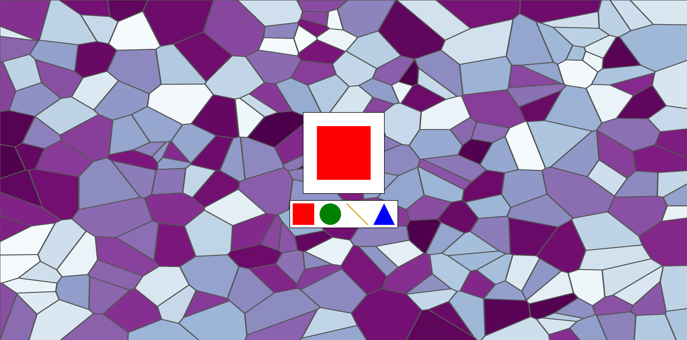
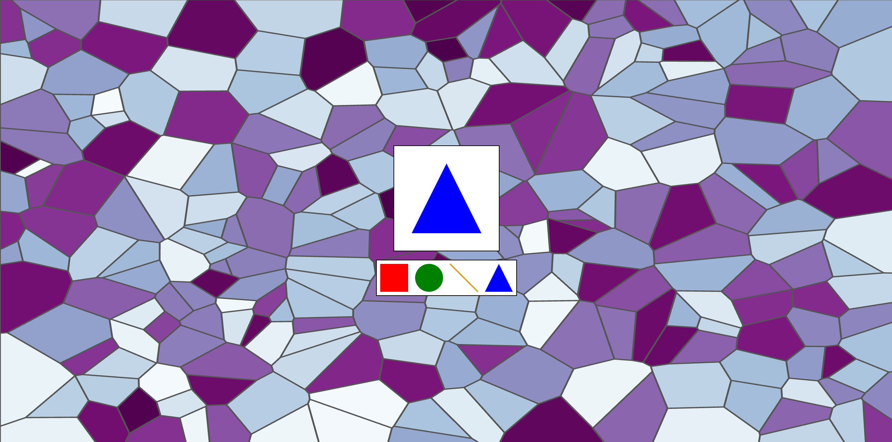

# Assignment 1 - Hello World: GitHub and d3

William Hanlon

Description:
I started by making the shapes required by the assignment in a container svg, and realized that it looked a lot like a selection menu. From there I created a svg above it that displays a larger version of whichever shape is chosen and animated between the ones chosen. I also wanted to explore how D3 could be used visually so I picked my favorite of the designs I saw to see if I could come up with a way to turn it into a background for the shape picker. I went with a Voronoi graph that randomly picks points, as I liked how it reminded me of stained glass. For the color palette (the really long const, sorry for the graders scrolling through it), I found a color scheme for d3 page, on the same website that the design gallery was on, and used it.

I did not start with any code, but I used these for references and for other things.
Sources:
https://observablehq.com/@d3/color-schemes - color palette site
https://observablehq.com/@d3/voronoi-labels - the specific inspiration for my background
https://d3js.org/d3-dispatch - used to connect the clicking to the animation
https://d3js.org/d3-delaunay/voronoi - used starting code for voronoi to generate my background

Technical Achievements
- Animated shape selector: I used D3 transitions to shrink and enlarge shapes around the center of the display
- Linked View: I used d3.dispatch as an event handler to connect clicks in the selection panel to a larger display
- Voronoi background: I generated 250 random points, and used the Delaunay triangulation to render each cell as an svg path

Design Achievements
- Stained glass appearance: randomly selected colors from the palette to fill in the cells of the voronoi background to create a stained glass effect
- Clear distinction between the background image and foreground
- Shape selector and window is centered
